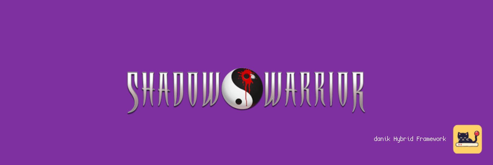

# jfSW for MiSTer

Shadow Warrior and its addons Wanton Destruction and Twin Dragon on [MiSTer FPGA](https://github.com/MiSTer-devel/Main_MiSTer/wiki) as a hybrid port.

The game is [JFShadowWarrior](https://github.com/jonof/jfsw), Jonathon Fowler's port of 3D Realms' Shadow Warrior (1997) on his port of Ken Silverman's Build engine, with the engine's classic software renderer. It runs on the MiSTer's ARM CPU. The jfSW FPGA core provides native 15kHz video (CRT, VGA and HDMI) at 320x200, 640x200, 320x240 or 640x240, 44.1kHz audio, an FM chip for the AdLib music of the shareware version, and keyboard, mouse and gamepad input. The two halves talk through shared DDR3 memory.

> **Beta.** Expect rough edges and please report problems in the issues.
>
> **Disclaimer:** AI is being extensively used to speed up development, but the project is well-maintained and supported.

  
  

## Requirements

- **danik_hybrid_ports**, the launcher: run it **once** from the MiSTer's `Scripts` menu ([The launcher](#the-launcher)). Without it the core says "Game not running".
- **Game data**, which is not included: `SW.GRP` of Shadow Warrior 1.2, from the original CD or from *Shadow Warrior Classic Complete* / *Classic Redux* (GOG, Steam), or of the shareware version. The addons *Wanton Destruction* (`WT.GRP`) and *Twin Dragon* (`TD.GRP`, which needs the full game's `SW.GRP` as well) are optional.
- **Recommended:** a gamepad with two analog sticks and analog triggers, like an Xbox or PlayStation controller. A gamepad without them works but is not recommended. The game can also be played with a keyboard and mouse.

## Installation

With `update_all` (Downloader 2.4 or newer, which update_all keeps up to date):

1. Copy [`downloader_danik_hybrid_ports.ini`](https://raw.githubusercontent.com/ItsDanik/Hybrid_MiSTer/main/launcher/downloader_danik_hybrid_ports.ini) to the root of your SD card (`/media/fat`).
2. Run `update_all`. That installs the launcher, **danik_hybrid_ports**, in `Scripts`.
3. Run **danik_hybrid_ports** from the `Scripts` menu, tick the games you want and press *X: Apply*. They are installed, and update_all keeps them up to date.
4. Copy **everything** in the game's folder (the one with `SW.GRP`) to `/media/fat/games/dnk/jfSW/`, with its folders as they are, and leave nothing out (files the port does not use do no harm). The port finds in it:
   - `SW.GRP`
   - the music, which is the audio of the game's CD: `Track02.ogg` to `Track14.ogg`, there or in a folder `music`. Without them the full game has no music, only its sound effects (see [NOTES.md](NOTES.md#music)). The shareware version needs none: its music is in its `SW.GRP`.
   - optional: `WT.GRP` and `TD.GRP`, there or in a folder `addons`.

   The whole folder of *Shadow Warrior Classic Redux* (the one with `SW.GRP`, `addons` and `classic`) can be copied as it is: the addons and the music (`classic/MUSIC`) are found in it.
5. Load the game from the `Other` menu, e.g. **dnk-Shadow Warrior**, or from the `Hybrid Ports` folder if you moved the games there in the launcher.

> [!NOTE]
> The game data can go on a USB drive instead, into the same folder there (`/media/usb0/games/dnk/jfSW/`): the game looks for it there first, and then keeps its settings and saved games there as well. Everything else stays on the SD card.

The game files are known by their contents, whatever their names. The menu entry of Shadow Warrior starts the shareware when the full game is not there. When a game's files are missing, the core says which files to copy where. Each game keeps its own OSD settings and button mappings. The core file itself (`_Other/dnk/dnk-jfSW_*.rbf`, or from *Recent*) lists the games that are there to pick from; quitting a game then returns to the list. The game's log is in `/media/fat/logs/dnk/jfSW/jfsw.log`. Settings (`sw.cfg`) and saved games (`game0.sav` to `game9.sav`) are in `/media/fat/games/dnk/jfSW/` (on the USB drive, if the game data is there).

## The launcher

**danik_hybrid_ports** is what turns a menu entry into a running game. Once you've run it from the `Scripts` menu, it starts with the MiSTer, watches which core is loaded, and starts the game whenever a hybrid port's menu entry is loaded. It serves all our hybrid ports at once and updates itself through `update_all`.

Run it from the `Scripts` menu again whenever you want to change something. Its screen has:

- **Launcher**: on or off. Off, the ports' games no longer start (the core says "Game not running"), until you turn it on again.
- **Menu entries**: where the games appear in the MiSTer menu:
  - **Other, as dnk-\<Title\>**: each game in the `Other` menu, e.g. **dnk-Doom** (the default).
  - **Other/Hybrid Ports**: all of them in a *Hybrid Ports* folder in `Other`, without the `dnk-` in front.
  - **Main menu/Hybrid Ports**: a *Hybrid Ports* folder of its own in the main menu, next to `Arcade`, `Console` and `Other`.

  Moving them keeps each game's settings and button mappings. Favourites, recent lists and Zaparoo tags that point at the old place have to be made again.
- **The ports and their games**, a tickbox each. Tick what you want, untick what you don't.

*X: Apply* installs what is ticked and removes what is not, through Downloader, and moves the menu entries if you chose another place. When a port is removed, your game data, saved games and settings stay, and ticking it again brings it back as it was.

## OSD options

| Option | |
|---|---|
| Aspect ratio, Scale, Scandoubler Fx, Stereo Mix | as in other cores |
| FPS Counter | shows the pictures per second in the top left corner |
| HDMI Only | **Yes** if no CRT is connected: resolutions of 640x400 and more are then progressive instead of interlaced, and so is the core's own screen before the game, which moves at 60 pictures a second for a CRT and shows fine lines on HDMI without it. The analog output is switched off while one is shown, so that a 15kHz screen can never get such a signal. jfSW has no such resolution, so nothing changes in the game. Not needed with `forced_scandoubler=1` (VGA monitor); not there with `direct_video=1` |
| CRT Options | **Horizontal Size**: the picture's width **Horizontal Pos**: moves it left or right **Vertical Pos**: moves it up or down **HUD (Top)**: always greyed out, the game has nothing at the top **HUD (Bottom)**: lifts the status bar (or the mini bar) 0 to 24 lines off the bottom edge (default 0), at 240 lines  For a 15kHz screen: fits the picture to it and keeps the status bar out of the overscan. HDMI is not affected; not there with `forced_scandoubler=1` |
| Resolution | **320x200**: as the original (default) **640x200**: twice the detail across, same picture size **320x240**: the view fills the whole screen **640x240**: both  Always at 15kHz. With 240 lines the status bar is drawn over the view at the *HUD (Bottom)* margin; menus and pictures stay at 200 lines, centred, never stretched. Applies at once |
| L. Stick Sensitivity, R. Stick Sensitivity | how fast the left stick (walk, strafe) and the right stick (turn, look) move the player, 25% to 300%. They apply at once and take the place of the axis scale in the game's own menu |
| Limit Vertical Look | **On**: half of the game's own range up and down (default) **Off**: the whole range  The Build engine shifts the picture instead of turning the camera, which distorts it the further you look up or down. For the keys, the mouse and the gamepad alike |
| Music | **MIDI**: the core's synthesizer, or an MT32-pi when one is connected and on (default) **FM chip**: as an AdLib card played it  For the shareware version's music, which is MIDI; the full game's is the CD's (see [NOTES.md](NOTES.md#music)). Applies at once |
| SoundFont | **Default**: GeneralUser GS, which comes with the port **1** to **7**: your own `.sf2` files in `games/dnk/SoundFonts/`, in the order of their names, or as the MIDI Player core sets them  A SoundFont that is missing, damaged or too big (over 64 MB of samples) is said in the MiSTer's info box, and the music goes to the FM chip |
| MT32-pi | **MT32-pi**: On (default) or Off, the core's synthesizer as without it **MT32-pi Synth**: SoundFont (default) or MT-32 (it needs the MT-32 ROMs on the Pi's card) **MT32-pi ROM**: MT-32 v1, v2 or CM-32L **MT32-pi SoundFont**: Pi's own (default) or one of the first eight on its card **Reset Hanging Notes**: the Pi stops all its notes, the music goes on  Only there while an MT32-pi answers on the user port. Apply at once |
| Cheats | **God Mode**: nothing hurts you **No Clipping**: walk through walls **Give All**: every weapon with full ammo, armor, the inventory items and all keys **Next Level**: completes the level |
| Reset | starts the game again from its beginning, as the USER button does |
| Save Diagnostic Report | the last line: see [If something is wrong](#if-something-is-wrong) |

## Controls

- **Keyboard and mouse:**

| Key | Action |
|---|---|
| W, S (or up, down) | Walk forward, back |
| A, D | Sidestep left, right |
| Mouse (or left, right) | Turn. Moving the mouse up and down looks up and down |
| Left mouse button (or right Ctrl) | Fire |
| E (or right mouse button) | Open, use |
| Space | Jump |
| Left Ctrl | Crouch |
| Shift | Run (Caps Lock: always run) |
| 1 - 0 | Weapons |
| R, Q (or mouse wheel) | Next, previous weapon |
| F (or Enter), `[`, `]` | Use the inventory item, previous and next item |
| Page Up, Page Down, Home, End | Look and aim up and down |
| Tab | Map |
| Esc | Menu |

- **Gamepad** (default mapping):

| Button | Action |
|---|---|
| Left stick | Walk and strafe |
| Right stick | Turn, look up and down |
| D-pad | Walk and turn |
| R (RB / R1) | Fire |
| B (Xbox A / PlayStation Cross) | Open, use |
| A (Xbox B / PlayStation Circle) | Jump |
| L (LB / L1) | Crouch |
| Y (Xbox X / PlayStation Square) | Next weapon |
| X (Xbox Y / PlayStation Triangle) | Use the inventory item |
| Select | Map |
| Start | Menu |

Change the buttons in the OSD under *Define jfSW buttons*. *Menu OK* and *Menu Back* there are only needed for a spare button without a game function. While the OSD is open, the game gets no input.

> [!WARNING]
> A button left without a name in *Define jfSW buttons* does not reach the game at all, except L2/R2, L3/R3 and *Menu OK* / *Menu Back*. Name every button there, or leave the definition as it is. To go back to the default buttons, delete `config/inputs/jfSW_*_input_*_v3.map` (each game has its own) on the SD card.

The game's own menu can change what each gamepad button does: *Options*, *Input Menu*, *Controller Buttons Setup*. Change the actions there rather than in the OSD; a button the OSD leaves without a name never reaches the game, so its menu cannot bind it.

Naming a saved game without a keyboard: up/down changes the last letter, right adds a letter, left removes one, Menu OK confirms.

## If something is wrong

If the game stutters, the sound breaks up or something else is wrong, open the OSD while it happens and pick **Save Diagnostic Report**, the last line of the menu. The game keeps running; MiSTer's info box says the report is saved in `games/dnk/diagnostics/` on the SD card. Send that file (`jfSW_<date>_<time>.zip`) with a few words on what went wrong.

The report has the setup (versions, the video and audio lines of `MiSTer.ini`, the OSD settings), how the last 60 seconds went, the game's log and a screenshot. Nothing else: no network settings, addresses, saved games or lists of your files.

## Building

How the port works, how to build it and notes for development: [NOTES.md](NOTES.md).

## Support

If you enjoy this project, you can support my work on [Patreon](https://www.patreon.com/itsdanik).

## Credits

- **[JFShadowWarrior](https://github.com/jonof/jfsw)**, **[JFBuild](https://github.com/jonof/jfbuild)**, JFAudioLib and JFMACT by Jonathon Fowler and contributors.
- **Shadow Warrior** by 3D Realms Entertainment, who released its source code in 2005.
- **Build engine** by Ken Silverman.
- **Apogee Sound System** by James R. Dose: its AdLib MIDI driver, in the form [EDuke32](https://www.eduke32.com) keeps it in, is the one that plays the music on the FM chip.
- **[JTOPL](https://github.com/jotego/jtopl)** by Jose Tejada (jotego): the FM chip in the core.
- **[GeneralUser GS](https://www.schristiancollins.com/generaluser.php)** by S. Christian Collins: the SoundFont of the core's MIDI synthesizer, which comes with the port, its licence next to it.
- **[libogg and libvorbis](https://xiph.org)** by the Xiph.Org Foundation.
- **[SDL](https://libsdl.org)** by Sam Lantinga and contributors.
- **[MiSTer](https://github.com/MiSTer-devel)** by Sorgelig and the MiSTer-devel contributors: the framework and Template_MiSTer.
- **[MiSTer Frontier](https://github.com/MiSTerOrganize/MiSTer_Frontier)** by MiSTer Organize: thank you for the inspiration. Hybrid cores on the MiSTer, and the way their game is launched (a daemon that watches the loaded core and runs a script from its games folder), were inspired by MiSTer Frontier.

This project and its maintainers are in no way associated with or endorsed by 3D Realms, Devolver Digital or any other holder of rights in Shadow Warrior. It does not include any game data.

## License

The top-level scripts, tools and documentation are licensed under the [GPL-3.0](LICENSE). The components keep their own licenses: the part of the shared framework the game is linked with (`hybrid/hps/`) is GPL-2.0-or-later, the rest of `hybrid/` GPL-3.0 except where its files say otherwise, JFShadowWarrior is GPL-2.0-or-later (`jfsw/GPL.TXT`) and the Build engine in it is under Ken Silverman's Build license (`jfsw/jfbuild/buildlic.txt`: free of charge, no commercial use), libogg and libvorbis are BSD, SDL and the SDL drivers in `hybrid/sdl2` are zlib, the FPGA core and the MiSTer framework are GPL-2.0 (`core/LICENSE`, with the core's own sources GPL-2.0-or-later), JTOPL in it is GPL-3.0 (`hybrid/rtl/jtopl/LICENSE`).
